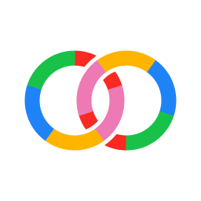
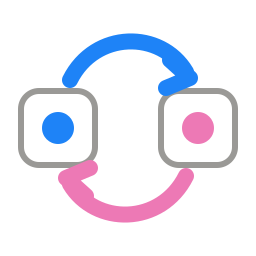
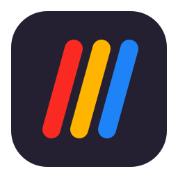
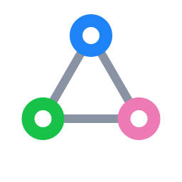
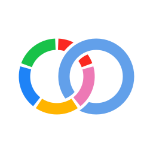
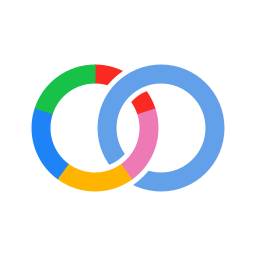
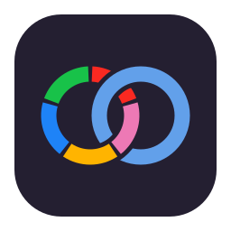
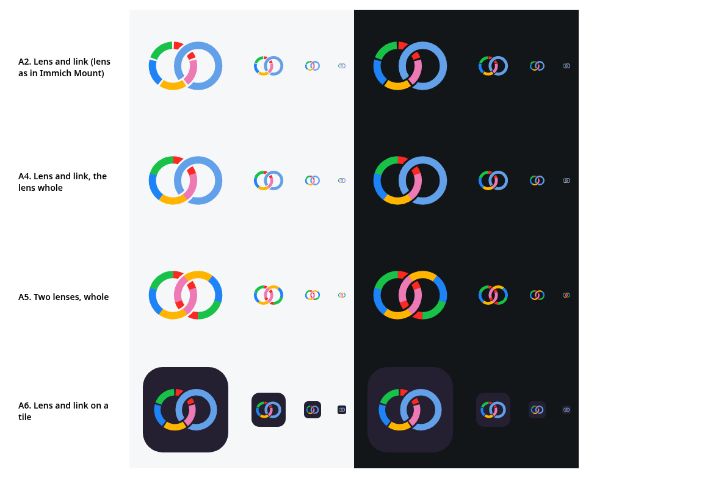
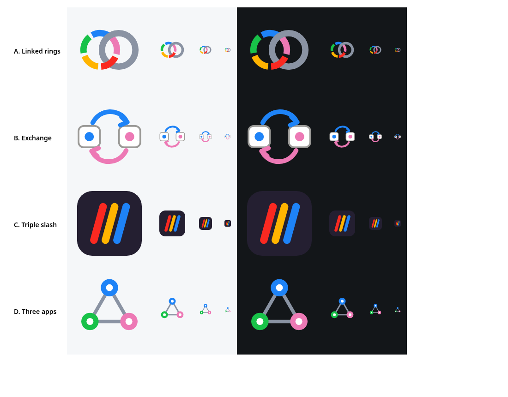

# Logo ideas

Four ideas for the immich-crosslink logo. **A6, the lens and link on a tile, is the logo for now** (`site/assets/logo.svg`, with `mark.svg`, A2 without the tile, for use beside text); the others stay here for a later look. Each takes Immich's colours (red `#FA2921`, pink `#ED79B5`,
yellow `#FFB400`, blue `#1E83F7`, green `#18C249`) but none of its shapes, as Immich Mount's icon does, so nothing
looks like an official Immich mark.

| | Idea | What it says | At small sizes |
|---|---|---|---|
|  | **A. Linked rings** (variants below) | Two rings in Immich Mount's lens colours, linked like a chain: one app joined to another | Holds to 32 px |
|  | **B. Exchange** | Two apps, a link going each way | Reads as a generic sync icon; blurs at 16 px |
|  | **C. Triple slash** | The `///` every crosslink starts with (`immich-crosslink:///`), in three of the colours, on a tile | Clear down to 16 px, light and dark |
|  | **D. Three apps** | Apps finding each other, joined | Clear, but generic (a network or share icon) |

## A. Linked rings, the variants

The rings follow Immich Mount's lens: the same five colours in its order, clockwise from the top (red, pink, yellow,
blue, green), and its ring's weight. They link like a chain: each ring passes over the other once and under it once,
with a see-through gap cut where it passes under, so the link reads on any background.

| | Variant | Notes |
|---|---|---|
|  | **A2. Lens and link** | Immich Mount's lens as it is, with its five segments, linked with a plain ring in Mount's light glass blue. The segment gaps compete with the link's |
|  | **A4. Lens and link, the lens whole** | The same without the segment gaps: the only gaps are the link's |
|  | **A5. Two lenses, whole** | Two lenses, the second turned half a turn so their colours differ where they cross: one app linked with another. The most balanced |
|  | **A6. Lens and link on a tile** | A2 on Mount's lens-barrel tile, for an app icon or a favicon |

## All four ideas

At 160, 64, 32 and 16 px, on light and dark (A as first drawn):

The chosen one gets a favicon, a mark for the site's header, and a version without the tile for use beside text.
