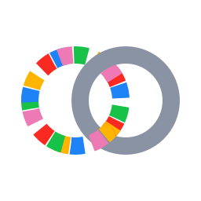

# Logo ideas

Four ideas for the immich-crosslink logo, not chosen yet. Each takes Immich's colours (red `#FA2921`, pink `#ED79B5`,
yellow `#FFB400`, blue `#1E83F7`, green `#18C249`) but none of its shapes, as Immich Mount's icon does, so nothing
looks like an official Immich mark.

| | Idea | What it says | At small sizes |
|---|---|---|---|
|  | **A. Linked rings** | Immich Mount's lens (its ring of five colours) linked with another app's ring: the family, joined to others | Holds to 32 px; the link blurs at 16 |
|  | **B. Exchange** | Two apps, a link going each way | Reads as a generic sync icon; blurs at 16 px |
|  | **C. Triple slash** | The `///` every crosslink starts with (`immich-crosslink:///`), in three of the colours, on a tile | Clear down to 16 px, light and dark |
|  | **D. Three apps** | Apps finding each other, joined | Clear, but generic (a network or share icon) |

All four on light and dark, at 160, 64, 32 and 16 px:

The chosen one gets a favicon, a mark for the site's header, and a version without the tile for use beside text.
